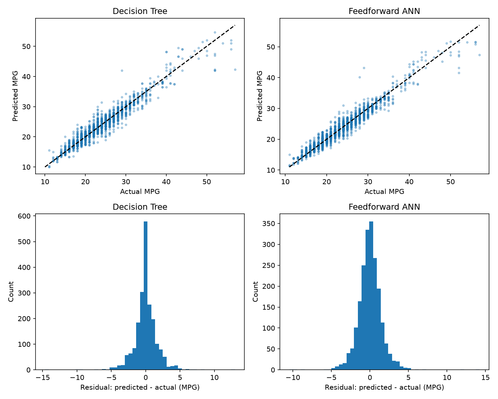

# Vehicle Fuel Efficiency Prediction - Endterm

Predict EPA combined **US MPG** from vehicle specifications. This is supervised
regression: MAE in MPG is the primary metric; RMSE and R-squared are secondary.
Higher MPG means greater fuel efficiency.

The endterm continues the midterm dataset and regression pipeline, adding
**K-Means, PCA, a PyTorch feedforward ANN, refined classical tuning and a unified
six-model comparison**. The shared data and preprocessing remain the foundation.

## Start here

Open [`notebooks/endterm/project.ipynb`](notebooks/endterm/project.ipynb) for the
integrated defense report. It shows training-only data checks and EDA, then reads
the saved tuning, clustering, PCA, ANN and evaluation artifacts without retraining
or evaluating the holdout again.

| Notebook | Purpose | Execution behavior |
|---|---|---|
| `00_eda.ipynb` | Data audit and four interpreted EDA plots | Uses train only; refreshes EDA figures |
| `01_clustering.ipynb` | K-Means search and engine profiles | Reads saved results and figures |
| `02_pca.ipynb` | Train-only PCA and strict cluster overlay join | Recomputes PCA in memory and checks saved results |
| `03_ann.ipynb` | Full ANN implementation walkthrough and training history | Retrains the same four declared candidates and refreshes ANN artifacts |
| `04_evaluation.ipynb` | Six-model comparison and error analysis | Reads saved results and figures |
| `project.ipynb` | Complete report for the defense | Reads final results and audits training data |

The report is the presentation entry point. The numbered notebooks explain the
individual methods; they are not six competing final reports.

## Final results

Validation uses the same 2,080 rows for every model. Classical models use grouped
five-fold CV within train. The ANN uses validation for early stopping and its
four-candidate selection; it has no claimed CV score. The winner is chosen by
validation MAE, with different tuning procedures explicitly acknowledged.

| Model | Validation MAE | Validation RMSE | Validation R-squared |
|---|---:|---:|---:|
| **Decision Tree** | **1.051024** | 1.636483 | 0.930256 |
| Feedforward ANN | 1.082715 | **1.522971** | **0.939596** |
| KNN | 1.089423 | 1.672234 | 0.927176 |
| Linear Regression | 2.018650 | 2.777868 | 0.799041 |
| Ridge | 2.020508 | 2.778423 | 0.798961 |
| Baseline (mean) | 4.661760 | 6.196671 | approximately 0 |

MAE and RMSE are in US MPG. Source:
[`model_comparison_validation.csv`](reports/results/endterm/model_comparison_validation.csv).
The tree uses `max_depth=None, min_samples_leaf=2`; KNN uses three neighbors,
Manhattan distance and uniform weights. Ridge selected `alpha=1.0`.
The ANN uses 40 encoded inputs, hidden layers 64 and 32 with ReLU, one linear
output, Adam at 0.001, batch size 64 and MSE on a train-standardized target.
Early stopping restored epoch 113 after stopping at epoch 133.

The 2,079-row holdout **was already used in midterm**. The final endterm table
records the fixed configurations on that previously used holdout; it is not a
new independent test and must not drive another model selection. Tree MAE is
1.073831 and ANN MAE is 1.078018 MPG. Full results:
[`model_comparison_test.csv`](reports/results/endterm/model_comparison_test.csv).

| Additional analysis | Finding |
|---|---|
| K-Means | `k=3`; centers near 4 cylinders / 2.04 L, 6 / 3.30 L and 8.46 / 5.22 L |
| PCA | PC1 retains 96.06% of variance in standardized cylinders and displacement |
| Validation error analysis | Tree MAE is 1.827 MPG for 241 hybrids versus 0.949 for 1,839 non-hybrids |

K-Means and PCA describe engine structure, not a replacement MPG predictor.
MPG was not used to fit or choose clusters. PCA variance is feature variance,
not prediction accuracy; retaining both components of two inputs is a rotation.



## Dataset and evaluation protocol

Source: [U.S. EPA / DOE FuelEconomy.gov](https://www.fueleconomy.gov/feg/ws/index.shtml).
The real `vehicles.csv` snapshot is scoped to model years **2015+**, excluding
EV, fuel-cell, plug-in-hybrid and specified non-comparable fuel entries.
Ordinary non-plug-in hybrids remain included.

- Prepared dataset: **13,975 rows, 14 columns**, including identifiers and target.
- Fixed seed-42 split: **9,816 train / 2,080 validation / 2,079 prior holdout**.
- Target: `mpg`, from EPA `comb08`; make/model and row ID are not predictors.
- Inputs: year, cylinders, displacement, technology flags, drive, transmission,
  vehicle class and fuel type, plus inherited `displacement_per_cylinder`.
- Exact duplicate records stay together across splits and training CV folds.
  Related make/model variants can still cross partitions.
- Imputation, scaling and encoding fit only on training data (inside each CV
  fold for classical tuning). The ANN target scaler also fits on train only.
- Snapshot SHA-256:
  `b1ff0e3071c46cdc1c99e0015878b98a01851462d7e447237ce2fc1294ccf303`.

See [`data/README.md`](data/README.md) for source, schema, cleaning and usage
terms, and [`docs/endterm_protocol.md`](docs/endterm_protocol.md) for the fixed
snapshot/split contract and evaluation limitations.

## Environment and execution

The tested CPU environment uses Python 3.12. Exact library versions are pinned
in [`requirements-endterm.txt`](requirements-endterm.txt), including PyTorch
2.15.0+cpu, scikit-learn 1.9.1, pandas 3.0.6 and NumPy 2.5.3.

From the project root in PowerShell, use the existing environment:

```powershell
.\.venv\Scripts\python.exe -m pytest -q
.\.venv\Scripts\python.exe -m vehicle_efficiency.neural_network --verify
.\.venv\Scripts\python.exe -m jupyter lab notebooks/endterm/project.ipynb
```

To set up another Python 3.12 environment:

```powershell
py -3.12 -m venv .venv
.\.venv\Scripts\python.exe -m pip install -r requirements-endterm.txt
.\.venv\Scripts\python.exe -m pip install -e . --no-deps
```

Obtain the team's existing `data/raw/vehicles.csv` and verify it with the ANN
`--verify` command. Downloading today's EPA file may change its hash and invalidate
comparison; do not replace the snapshot or reference manifest for the defense.
No download is needed on the current machine.

The numbered notebooks run independently from their first cell in the same
environment. For a full walkthrough use 00, 01, 02, 03, 04, then project.
Notebook 03 reruns the fixed experiment; use project for a presentation without
retraining. The saved comparison already includes final evaluation.
`vehicle_efficiency.endterm_compare` intentionally refuses new selection once
the final holdout table exists. Keep that safeguard and the recorded results.
Source implementations live in `src/vehicle_efficiency/`; historical top-level
result tables are retained for provenance and are not the endterm comparison.

## Contributions

| Member | Endterm contribution | Implementation commits |
|---|---|---|
| Aktore | PCA, cluster overlay, report integration and documentation | `2489abc`, `31097f4`, `c36ca09` |
| Khamza | Feedforward ANN, fixed experiment protocol, reproducibility and walkthrough | `eba318f`, `a0bf7a9` |
| Askhat | K-Means, classical refinement, comparison and error analysis | `316c517`, `34fed77`, `47b4919`, `b455bad` |

Shared midterm work includes data loading, cleaning, preprocessing, feature
engineering, EDA and the original supervised models. See
[`team tasks`](docs/endterm_team_tasks.md),
[`presentation outline`](docs/endterm_presentation_outline.md) and
[`submission checklist`](docs/endterm_submission_checklist.md).

## Limitations and next research

The selected data has no vehicle weight, horsepower, aerodynamics or real-world
driving conditions. EPA laboratory ratings do not guarantee a driver's fuel use.
Results do not cover pre-2015 or excluded powertrains. One snapshot/seed,
validation-based selection, related variants across partitions and prior holdout
use limit generalization claims. Treat small group results cautiously; do not
present group differences as causal or use predictions as certified fuel ratings.

Keep the same dataset for the endterm comparison. A future, separate robustness
study could predeclare make/model-grouped or time-based evaluation, or join
verified weight/horsepower data. Such a study requires fresh evaluation and
must be reported separately from these frozen results.
